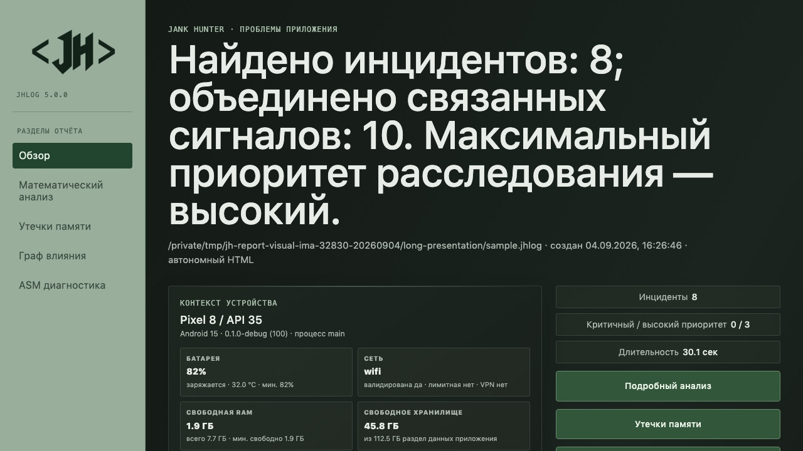
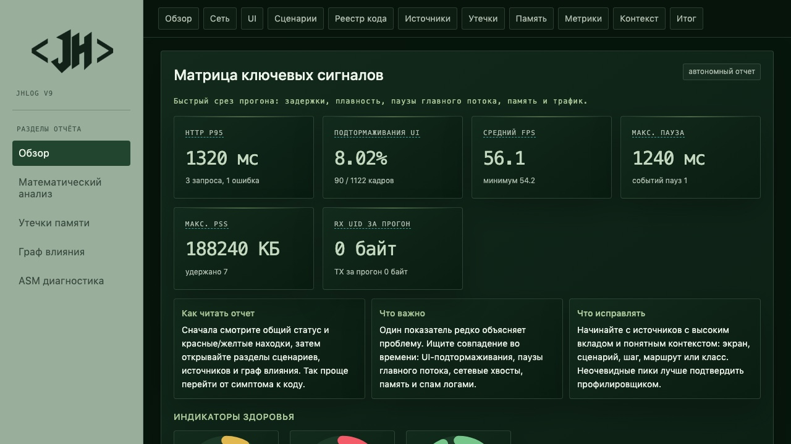
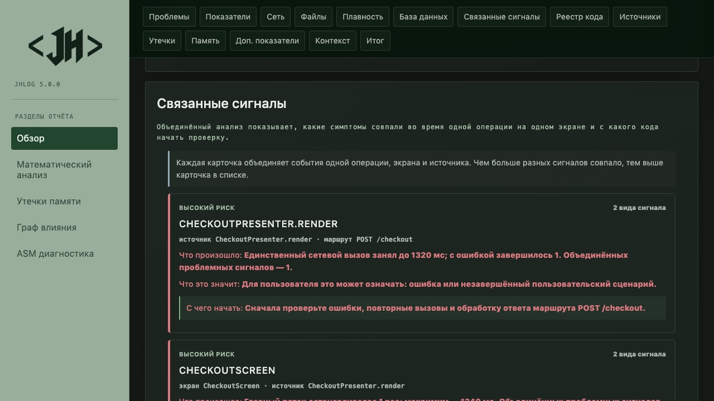
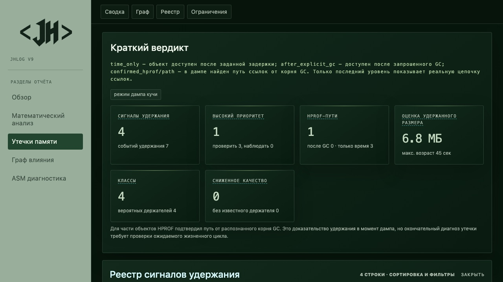
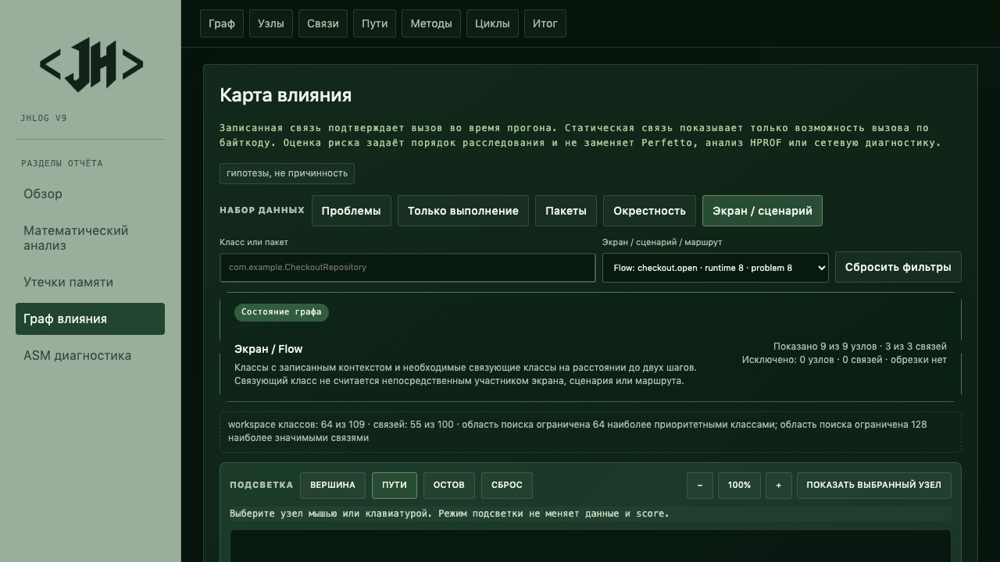
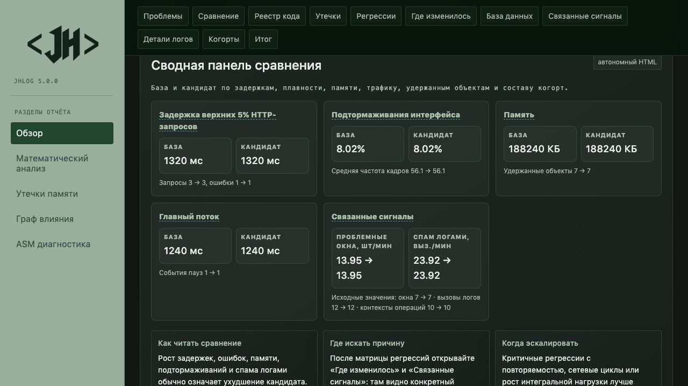

# Jank Hunter

Jank Hunter помогает понять, почему Android-приложение тормозит. Например, почему список подтормаживает при прокрутке, экран долго открывается, главный поток занят тяжёлой работой, сетевой запрос выполняется слишком долго или закрытый экран остаётся в памяти.

После подключения Jank Hunter записывает диагностические события в файлы `.jhlog` внутри приложения. Артефакты одного запуска, включая данные разных процессов и HPROF, хранятся вместе; завершённый запуск превращается в один `.jhlog.zip`. Файл, директорию активной сессии или архив можно скопировать на компьютер и открыть локальной утилитой `jankhunter`. Утилита создаёт готовый HTML-отчёт, а при необходимости экспортирует данные в JSON, CSV или JSONL. Сервер для работы не нужен, данные автоматически никуда не отправляются.

Jank Hunter не исправляет торможение автоматически. Он собирает факты, которые помогают найти проблемный экран, операцию, класс или метод.

## Как это работает

Обычная проверка состоит из четырёх шагов:

1. Подключить Jank Hunter к отладочной сборке приложения.
2. Запустить приложение и воспроизвести подтормаживание или другой проблемный сценарий.
3. Скопировать созданный `.jhlog.zip`, директорию текущей сессии или отдельные `.jhlog` с устройства.
4. Построить HTML-отчёт и проверить найденные проблемы.

Android SDK собирает данные во время работы приложения. Командная утилита анализирует их уже на компьютере, поэтому она не увеличивает нагрузку на приложение.

## Актуальные версии

| Компонент | Версия |
| --- | --- |
| Android SDK и Gradle-плагин | `1.0.13` |
| Командная утилита | `1.0.11` |
| Формат новых файлов JHLOG | `5.3.0`; чтение `5.0.0`, `5.1.0` и `5.2.0` сохранено |
| Плагин для Android Studio | `0.1.1` |

Для Android всегда используйте одну версию плагина и SDK:

```properties
jankHunterVersion=1.0.13
```

Версия `5.3.0` относится к формату файлов `.jhlog`, а не к Android SDK. Обновляйте SDK, Gradle-плагин и командную утилиту вместе: старый reader отвергает неподдержанную версию или обязательную возможность формата. При работе из исходников важна актуальность самой сборки CLI.

## Быстрое подключение к Android-приложению

### Вариант 1. Готовый скрипт

Этот вариант удобен, если Jank Hunter собирается из текущего репозитория. Сначала посмотрите, какие файлы будут изменены:

```bash
./scripts/integrate-android-project.sh \
  --target ~/work/MyApp \
  --module :app \
  --profile balanced \
  --include-package com.example.app \
  --storage-limit-mib 16 \
  --dry-run
```

Замените `~/work/MyApp` на путь к приложению, `:app` на имя Android-модуля, а `com.example.app` на пакет вашего кода.

Gradle-плагин собирается как отдельный composite build. Перед первым подключением опубликуйте его в тот же Maven-каталог, который будет использовать интегратор. Команда выполняется из корня Jank Hunter:

```bash
./android/gradlew -p android/jankhunter-gradle-plugin publishToMavenLocal \
  -Dmaven.repo.local="$HOME/work/MyApp/.jankhunter/maven" --no-daemon
```

Путь должен соответствовать `--target`; при другом `--maven-dir` используйте именно этот каталог. Затем запустите подключение:

```bash
./scripts/integrate-android-project.sh \
  --target ~/work/MyApp \
  --module :app \
  --profile balanced \
  --include-package com.example.app \
  --storage-limit-mib 16 \
  --verify
```

Скрипт выполнит следующие действия:

- соберёт Android-компоненты версии `1.0.13` и опубликует их в локальный Maven-репозиторий приложения;
- добавит Gradle-плагин и зависимость `jankhunter-android-sdk`;
- создаст блок `jankHunter { ... }` с переданными настройками;
- соберёт командную утилиту и положит её в `.jankhunter/bin/jankhunter`;
- проверит разрешение Gradle-задач выбранного Android-модуля. Флаг `--verify` не выполняет `assembleDebug`; сборка приложения показана ниже.

Перед изменением файлов скрипт создаёт резервную копию. Подробное описание и все параметры находятся в [`scripts/README.md`](scripts/README.md).

### Вариант 2. Ручное подключение

Если артефакты Jank Hunter уже доступны в Maven-репозитории проекта, добавьте в Android-модуль плагин и SDK одной версии:

```kotlin
plugins {
    id("io.jankhunter.android") version "1.0.13"
}

dependencies {
    implementation("io.jankhunter:jankhunter-android-sdk:1.0.13")
}
```

Добавьте минимальную настройку:

```kotlin
jankHunter {
    enabled.set(true)
    enabledBuildTypes.set(setOf("debug"))
    profile.set(io.jankhunter.gradle.JankHunterProfile.BALANCED)
    packages("com.example.app")
    storageLimitMiB(16)
}
```

Здесь нужно заменить только `com.example.app` на пакет приложения. Профиль `BALANCED` подходит для первой проверки и используется по умолчанию.

Ручной вызов `JankHunter.init(...)` обычно не нужен. Gradle-плагин добавляет `JankHunterAutoInitProvider`, который запускает сбор автоматически. Полное описание Android-настроек находится в [`android/README.md`](android/README.md).

## Первый диагностический отчёт

### 1. Соберите и запустите приложение

В корне Android-приложения выполните:

```bash
./gradlew :app:assembleDebug
```

Установите отладочную сборку, откройте нужный экран и повторите действие, во время которого приложение тормозит. Например, несколько раз откройте экран, прокрутите список или выполните сетевой запрос.

Во время сборки включённого варианта должна появиться строка:

```text
================JANK HUNTER 1.0.13 ENABLED================
```

### 2. Скопируйте журналы с устройства

Подключите устройство или запустите эмулятор. Оставаясь в корне Android-приложения, выполните:

```bash
mkdir -p logs
APP_ID=com.example.app
adb exec-out run-as "$APP_ID" tar -C files/jankhunter -cf - . | tar -xf - -C logs
```

В `APP_ID` укажите `applicationId` запущенной отладочной сборки. Команда `run-as` работает только для приложения, которое разрешает отладку.

Артефакты на устройстве находятся прямо в каталоге `context.filesDir/jankhunter`, без дополнительной директории `sessions` и без manifest:

```text
context.filesDir/jankhunter/
├── 2027-01-02T10-15-30.123Z_4_<run-id>/
│   ├── <process-instance-id>/
│   │   ├── jh-session-log.2027-01-02.<run-id>.4.jhlog
│   │   └── retained-*.hprof
│   └── <other-process-instance-id>/
│       └── jh-session-log.2027-01-02.<run-id>.4.jhlog
└── 2027-01-01T18-42-11.004Z_3_<run-id>.jhlog.zip
```

Директория обозначает текущую или ещё активную сессию. При следующем безопасном запуске завершённая сессия проверяется и атомарно заменяется одним ZIP с JHLOG и управляемыми HPROF всех процессов. Активная, неполная или повреждённая сессия не удаляется. При первом запуске новой версии SDK удаляются только распознанные старые плоские Jank Hunter-файлы; неизвестные файлы сохраняются.

`storageLimitMiB` ограничивает текущую запись и физический размер опубликованных архивов. При превышении архивного бюджета архивы вытесняются целиком от наименее недавно использованных, а при отсутствии истории доступа — от самых старых. Текущая сессия и неполные архивы в это вытеснение не входят.

### 3. Соберите утилиту и создайте отчёт

Если приложение подключено готовым скриптом, утилита уже находится в каталоге `.jankhunter/bin`:

```bash
./.jankhunter/bin/jankhunter inspect logs/*.jhlog.zip --out report.html
```

При ручном подключении сначала соберите утилиту в репозитории Jank Hunter. В примере ниже замените пути к обоим проектам на свои:

```bash
cd ~/work/jank-hunter/cli
make build
./bin/jankhunter inspect \
  ~/work/MyApp/logs/2027-01-01T18-42-11.004Z_3_<run-id>.jhlog.zip \
  --out ~/work/MyApp/report.html
```

Если Go не установлен, `make build` загрузит Go `1.22.12` в `cli/.tools/go`. Системная установка Go при этом не изменится.

Откройте `report.html` в браузере. Отчёт автономный: его можно перенести на другой компьютер или приложить к задаче вместе с исходным `.jhlog.zip`.

Все команды анализа принимают три эквивалентных вида входа: отдельный JHLOG, директорию одной сессии и `.jhlog.zip`. Старый сценарий с отдельными файлами остаётся доступен и не требует manifest:

```bash
./.jankhunter/bin/jankhunter inspect logs/current-session --out current.html
./.jankhunter/bin/jankhunter size logs/current-session.jhlog.zip --json
./.jankhunter/bin/jankhunter problems logs/single-process.jhlog --out problems.csv
```

Если Gradle-плагин создал дополнительные данные о коде, передайте их через `--artifacts-dir`:

```bash
./.jankhunter/bin/jankhunter inspect logs/*.jhlog \
  --artifacts-dir app/build/generated/jankhunter/debug \
  --mapping app/build/outputs/mapping/debug/mapping.txt \
  --out report.html
```

Параметр `--mapping` нужен только для сборок, обработанных R8 или ProGuard.

## Что смотреть в отчёте

Начните со страницы «Обзор»: в ней на первом месте проблемы приложения, их важность, местоположение, доказательства и следующие шаги проверки. Поиск и фильтры помогают перейти к нужному экрану, операции или участку кода.

Ошибки записи, неполное покрытие и другие ограничения сбора находятся отдельно: «Математический анализ → Качество данных». Неизвестные значения не считаются нулями. Индекс полноты `100%` не означает, что включена вся возможная инструментация; `-1` в JSON означает, что полноту определить нельзя.

Снимки ниже иллюстрируют разделы отчёта; детали оформления могут отличаться от текущей версии.



Затем откройте матрицу сигналов. Она показывает, где одновременно наблюдались долгая отрисовка кадров, занятость главного потока, медленные запросы, рост памяти и другие события.



Раздел операций помогает связать проблему с экраном или пользовательским действием.



Для каждого вывода проверяйте раздел с доказательствами. Статистическая связь помогает найти направление для проверки, но сама по себе не доказывает причину проблемы.

### Потоки и фоновые задачи

Отдельная страница причинной диагностики сначала показывает конкретные проблемы с измеренным последствием и метод, с которого стоит начать проверку. Затем можно раскрыть цепочку Thread, Executor/Handler, корутины или Worker: кто наблюдался при создании, кто запросил запуск или отмену, какой код выполнялся и сколько времени, CPU либо байт действительно измерено. Потоки самого Jank Hunter скрыты из основных чисел по умолчанию; фильтры позволяют отдельно смотреть код приложения, библиотек и системную работу. Неизвестный источник и потери журнала показаны явно.

Включайте возможность обычным Gradle DSL:

```kotlin
jankHunter {
    enable(io.jankhunter.gradle.JankHunterFeature.CONCURRENCY_DIAGNOSTICS)
    enable(io.jankhunter.gradle.JankHunterFeature.THREAD_SAMPLING)
    tuning.concurrency.detailedEnabled.set(false)
    tuning.concurrency.maxTrackedEntities.set(4096)
}
```

Для полного набора потоков и задач есть `enable(io.jankhunter.gradle.JankHunterFeatureBundle.CONCURRENCY_ALL)`; отдельные функции выключаются через `disable(...)`. Подробный режим включается отдельно параметром `tuning.concurrency.detailedEnabled.set(true)`. Настройки и пример release-сборки приведены в [Android SDK](android/README.md#причины-проблем-с-многопоточностью).

Происхождение класса определяется по артефакту сборки, а не по имени пакета. Подтверждённые `Thread.start`, первое выполнение `run`, вызов постановки задачи и фактический участок корутины обозначают разные факты: последнее не выдаётся за создание. Обычный Handler сохраняет исходный callback; точная связь post→dispatch доступна через opt-in `JankHunterTrackedHandler`. Для обычного Executor граница выполнения opaque delegate может быть неизвестна; точный путь дают контролируемый декоратор или `JankHunterTrackedExecutor`. Native-потоки участвуют только в общей нагрузке, без восстановленного Java/Kotlin creator.

CPU относится лишь к измеренным интервалам того же TID; неизвестные байты не превращаются в ноль. Общий heap процесса не распределяется по потокам. `JankHunterResources.use` наблюдает уже переданный объект, а не момент его открытия; acquisition/release требуют событий поддержанного API. Открытый ресурс без явного scope-контракта и работа, продолжающаяся на момент записи, сами по себе не объявляются утечкой. Отмена, interrupt и shutdown не доказывают завершение. События сохраняются с ограниченным бюджетом, потери видны в отчёте; старые журналы 5.0/5.1 читаются без выдуманных причинных связей. Наблюдение всех старых WorkInfo для полноты истории WorkManager 2.11.2 остаётся исключением: публичный API отдаёт весь список без `LIMIT`, поэтому пик временной памяти для входной выборки строго не ограничен.

### Удержание объектов и HPROF

Без HPROF отчёт различает объект, переживший задержку, и объект, оставшийся живым после явно запрошенной сборки мусора. Второе свидетельство сильнее, но ни одно само по себе не объясняет путь удержания.

HPROF позволяет найти путь от корня сборщика мусора к экземпляру нужного класса. Совпадение класса не доказывает, что найден именно объект, за которым наблюдал SDK. Усечённый путь и неизвестный размер помечаются отдельно. HPROF внутри session directory или `.jhlog.zip` автоматически связываются с этой сессией. Для старой плоской раскладки единственный `retained-*.hprof` рядом с логами CLI подключает автоматически; при нескольких кандидатах нужно явно выбрать `--heap-dump`.



Файл HPROF может содержать пользовательские данные. Не включайте сбор дампа памяти без отдельного решения о конфиденциальности.

### Связь проблемы с кодом

Если доступны данные о классах и вызовах, граф влияния помогает перейти от симптома к возможному классу или методу.



Статическая связь показывает возможный путь в коде. Она не означает, что этот вызов точно произошёл во время проверяемого прогона.

### Сравнение двух прогонов

Команда `compare` сравнивает базовый прогон с новым и показывает улучшения и ухудшения:

```bash
./.jankhunter/bin/jankhunter compare \
  --baseline baseline/before.jhlog.zip \
  --candidate candidate/after.jhlog.zip \
  --out compare.html
```



Подробное описание `inspect`, `compare`, экспортов и критериев проверки находится в [`cli/README.md`](cli/README.md).

Для сравнения собирайте отдельные повторы одного сценария в сопоставимых условиях. Дополнительные сегменты одного запуска не считаются независимыми повторами. Одинаковый физический файл, даже под другим именем или через ссылку, нельзя передать в обе стороны сравнения.

## Как выбрать профиль

| Профиль | Когда использовать |
| --- | --- |
| `MINIMAL` | Нужна только базовая статистика кадров с минимальной нагрузкой. |
| `BALANCED` | Обычная отладка приложения. Начните с этого профиля. |
| `FULL` | Нужен расширенный сбор во всех процессах для короткого диагностического прогона. |
| `RELEASE_SAFE` | Сбор в релизной сборке был отдельно согласован. |
| `TARGETED` | Нужно вручную включить только выбранные возможности. |

Настройки `CALL_GRAPH`, `METHOD_COUNTERS`, `MAIN_LOOPER` и `HEAP_DUMPS` могут заметно увеличить стоимость сбора или затронуть конфиденциальные данные. Не включайте их для длительного прогона без необходимости.

## Какие данные можно собрать

Конкретный набор зависит от выбранного профиля. Jank Hunter умеет фиксировать:

- время отрисовки кадров и длительные паузы главного потока;
- HTTP, WebSocket, SQLite, Room и транзакции базы данных;
- файловые операции, обработчики, исполнители и корутины;
- экраны, пользовательские операции и этапы их выполнения;
- жизненный цикл Android-компонентов и объекты, которые долго остаются в памяти;
- задачи WorkManager, Binder IPC и диагностические события приложения;
- связи между классами и фактически записанные вызовы методов.

Текст сообщений приложения не сохраняется. SQL-шаблоны очищаются от литералов, включая неоднозначные значения в двойных кавычках. При этом журналы содержат диагностический контекст, а HPROF может содержать данные приложения.

HTTP учитывает все обмены одного вызова и отдельно отмечает известность первого байта и объёма тела. Для запланированных задач задержка, заданная приложением, отделена от фактического опоздания. Подробные границы этих измерений описаны в [Android README](android/README.md#семантика-измерений).

## Если отчёт не создаётся

- Нет файлов `.jhlog`: убедитесь, что запущена сборка `debug`, а в выводе Gradle есть строка `JANK HUNTER 1.0.13 ENABLED`.
- `run-as` завершился ошибкой: проверьте `applicationId`, подключение устройства командой `adb devices` и возможность отладки приложения.
- Отчёт пустой: повторите проблемный сценарий, завершите его и снова скопируйте все сегменты одного запуска.
- Не видно связи с кодом: передайте каталог `build/generated/jankhunter/<variant>` через `--artifacts-dir`.

## Состав репозитория

- [`android/`](android/README.md) - Android SDK, Gradle-плагин и демонстрационное приложение.
- [`cli/`](cli/README.md) - локальная утилита анализа и экспорта.
- [`plugin-as/`](plugin-as/README.md) - плагин для Android Studio и IntelliJ IDEA.
- [`scripts/`](scripts/README.md) - подключение к приложению и автоматические проверки.
- [`benchmarks/`](benchmarks/README.md) - воспроизводимый контракт производительности.
- `assets/readme/` - иллюстрации разделов отчёта.

## Демонстрационное приложение

Чтобы посмотреть Jank Hunter без подключения к своему проекту, выполните:

```bash
./run-sample-app.sh
```

Скрипт найдёт подключённое устройство или запустит эмулятор, установит приложение и покажет доступные команды. Команда `report` создаёт отчёт по собранным данным.

## Проверки проекта

```bash
cd cli
make test
npm run visual-regression

cd ../android
./gradlew detekt \
  :jankhunter-gradle-plugin:test \
  :jankhunter-runtime:testDebugUnitTest \
  :jankhunter-okhttp3:testDebugUnitTest \
  :jankhunter-workmanager:testDebugUnitTest \
  :sample-app:assembleDebug \
  --no-daemon

cd ..
./scripts/gradle-plugin-smoke.sh
python3 -m unittest \
  scripts.test_scripts \
  scripts.test_gradle_plugin_repositories \
  scripts.test_jank_hunter_ci
```

Проверка на устройстве запускается командой `./scripts/android-e2e.sh`. Сравнение производительности запускается командой `./scripts/performance-baseline.py`.

## Публикация в Maven Local

Android SDK и командная утилита выпускаются независимо. Текущая версия Android-компонентов берётся из `android/gradle.properties`:

```properties
jankHunterVersion=1.0.13
```

Из корня Jank Hunter выполните обе команды: первая публикует SDK-модули, вторая - отдельный Gradle-плагин и его marker:

```bash
cd android
./gradlew publishToMavenLocal --no-daemon --console=plain
./gradlew -p jankhunter-gradle-plugin publishToMavenLocal --no-daemon --console=plain
```

По умолчанию артефакты попадут в `~/.m2/repository`. В приложении этот репозиторий должен быть подключён и для плагинов, и для зависимостей. При повторной публикации `1.0.13` обновите зависимости приложения через `--refresh-dependencies` и пересоберите CLI. Интегратор использует другой каталог - `<target>/.jankhunter/maven`; публикация только в `~/.m2` его не обновляет.

Локальная публикация не создаёт релизный тег и не отправляет артефакты во внешний репозиторий. Перед отдельным выпуском проверьте тесты, сборку внешнего приложения и созданные отчёты.

## Работа над изменениями

Для задач с участием ИИ используйте Spec Kit монорепозитория: specify → clarify → plan → tasks → analyze → implement. Русские SDD-артефакты размещайте в `specs/<NNN>-<имя>/`; `.ai/tasks/` остаётся архивом прежних задач. Владельцы изменяемого кода определяются `CODEOWNERS` монорепозитория. Измерения на JVM и эмуляторе отделяйте от измерений на физическом Android-устройстве; методика описана в [benchmarks/README.md](benchmarks/README.md).


### Снимки системных потоков

`JankHunterConfig.builder().threadSamplerEnabled(true).threadSampleIntervalMs(5_000)`
включает экспериментальные снимки `/proc/self/task` на существующем фоновом планировщике.
По умолчанию сбор отключён. Интервал не меньше 500 мс, максимум 2048 чтения за снимок;
ошибки и превышение лимита обозначаются как неполнота. Одновременно writer удерживает
не более одного ожидающего снимка. При сборе архива запрашивается свежий снимок.

В CLI/HTML раздел «Потоки» показывает число прочитанных потоков, поколения TID по системному
времени старта, имена, состояния ОС, исходные CPU-тики, сравнение точек и наблюдаемые интервалы.
Сравнение запусков сопоставляет имя процесса, явно отмечая неоднозначные сессии и отсутствие
телеметрии. Java ID/состояния доступны при подтверждённой связи через run-хук; первый снимок не означает запуск
приложения, а потоки между снимками могут быть пропущены. Снимки не являются атомарными.
Полный реестр заданий и контекстные связи потоков пока находятся в разработке.

### Каталог классов WorkManager

При включённой функции `WORKERS` плагин приложения собирает конкретные классы WorkManager
из приложения и упакованных зависимостей до R8, независимо от запусков и WorkerFactory.
Каталог упаковывается в APK/AAB и один раз за эпоху сбора переносится в `.jhlog` на фоновом
планировщике. CLI показывает его в разделе «Фоновые задачи», даже если попыток выполнения нет.
Имена исходные: R8 может удалить или объединить классы; каталог не меняет их достижимость.
Динамические модули вне базового приложения не входят в область каталога.

Лимиты: 4096 классов и 128 КиБ на документ; превышение лимита и неразрешённые иерархии
отмечаются явно. CLI удерживает максимум 32 документа с указанием процесса и журнала,
HTML выводит по 100 классов на страницу с поиском. Отсутствующий, нечитаемый и слишком
большой каталог отличаются от доступного пустого каталога. Старые журналы не получают
вымышленный пустой каталог. Новый record type 29 требует обновления CLI.


### Реестр заданий WorkManager

Опциональный адаптер для WorkManager 2.11.2 подключается явно, после инициализации вашего WorkManager:

```kotlin
JankHunter.reconfigure("work-registry") { builder ->
    builder.workerRegistrySource(WorkManagerRegistrySource(WorkManager.getInstance(context)))
        .workerRegistryIntervalMs(30_000)
}
```

Настройку можно передать и в первоначальный `JankHunterConfig`. `reconfigure` применяет
новые настройки к последней принятой конфигурации: незаданные параметры сохраняются,
включая выключенные флаги, пороги, источник worker registry и политику хранилища.
Для изменения или сброса параметра явно вызовите соответствующий setter. Выключенный
runtime и `enabled(false)` не включаются от посторонних обновлений. Явный
`setRuntimeEnabled(true)` сохраняет запрос даже при глобальном или процессном запрете:
пока запрет действует, SDK не стартует и метод возвращает `false`; после явного снятия
запрета через `reconfigure` запрос может быть выполнен. `binaryStorage(...)` в updater
явно меняет хранилище, `binaryStorage(null)` возвращает встроенное; без setter сохраняется
последний выбор, в том числе сделанный через `switchBinaryStorage`. Конфликтующие или
устаревшие обновления возвращают `false`, не публикуя частичные параметры. Отложенные режимы
наблюдения сохраняются и применяются со следующего процесса. Runtime создаёт сборщик для каждой эпохи, отменяет
выборку при остановке и не принимает старые callback в новую эпоху.

### Переключение механизма наблюдения

`JankHunterConfig.Builder.taskObservationMode(...)` выбирает механизм для задач и
автоматических callback-обёрток, `coroutineObservationMode(...)` — независимо для корутин.
По умолчанию оба значения `JankHunterExecutionObservationMode.WRAPPERS`.
`IN_PLACE` сохраняет исходные Runnable, Callable, Handler callback и OnClickListener;
фабрики исполнителей возвращают исходный исполнитель. Наблюдение выполняется короткими
входами/выходами в подготовленных методах, без JH-обёртки вокруг всей пользовательской операции.

Удалённую конфигурацию получает и сохраняет приложение. Передавайте сохранённый выбор
при первой инициализации SDK в новом процессе. Для управляемой приложением инициализации
отключите автоматическую в Gradle:

```kotlin
jankHunter { autoInit.set(false) }
```

```kotlin
JankHunter.init(context, JankHunterManifestConfig.read(context).toBuilder()
    .taskObservationMode(JankHunterExecutionObservationMode.IN_PLACE)
    .coroutineObservationMode(JankHunterExecutionObservationMode.IN_PLACE)
    .build())
```

Выбор фиксируется при первой привязке конфигурации к процессу, в том числе при выключенном
runtime. Изменение через `reconfigure` сохраняет запрос для следующего процесса;
`shutdown/init` в том же процессе режим не переключает. SDK не сохраняет удалённое значение
между процессами: это обязанность хоста. Неизвестную строку удалённого провайдера хост должен
обработать до передачи типизированного enum в SDK. Не используйте непроверенный `valueOf`.
`JankHunter.executionObservationModes()` возвращает активную пару,
`requestedExecutionObservationModes()` — текущий запрос. `setRuntimeEnabled(false)`
продолжает немедленно запрещать новые события в обоих режимах; повторное включение
восстанавливает допуск хуков. Перенастройка хранилища не включает отключённый runtime.

Оба механизма подготовлены одним плагином. Для исполнительных событий `IN_PLACE` нужны
включённые соответствующие функции инструментации и concurrency diagnostics. Поддерживаются
подготовленные `run`, `call`, `invokeSuspend`, `onClick` и доказанные через LambdaMetafactory
синтетические тела задач/колбэков. Для платформенного, динамического и другого неподготовленного
кода покрытие остаётся частичным. Скрытого возврата к обёрткам нет.

Совпадение объекта отправки и receiver метода не доказывает конкретную отправку:
повторные отправки и прямые вызовы могут быть неразличимы. `IN_PLACE` сохраняет наблюдения
отправки и исполнения отдельно; связи builder/job корутины и operation context клика
также могут быть неизвестны. Отчёт показывает активный/запрошенный режим на старте записанных сессий и ограничения; это не запрос текущего состояния работающего процесса.
Диагностический compare не выдаёт сопоставимую дельту для разных или смешанных объявленных
режимов. Нулевые CPU и неизвестные CPU остаются разными состояниями.

Снимок всё ещё может попасть в исполняющийся короткий хук. Явные адаптеры SDK, например
базовый класс Worker и явно используемый TrackedExecutor, сохраняют собственные методы в стеке. Новая стратегия устраняет
автоматическое охватывание поддержанных операций; это не гарантия отсутствия любого JH-кадра.
В новом режиме transport и writer не ждут освобождения очереди даже при ненулевых
запрошенных admission-бюджетах. Потери учитываются отдельно.

В `JankHunterTrackedHandler` каждый handle отменяет только своё размещение, включая
повторную постановку одного Runnable и выключенный runtime. Для исходного callback
используется штатный `Message.obj` как непрозрачный токен размещения; это уже имеющаяся
слабая ссылка handle, без дополнительной callback-обёртки. Специализированному Handler,
который анализирует `Message.obj`, нужно учитывать этот контракт opt-in адаптера.

### Фильтрация методов и исполнительные сегменты

`tuning.methodFiltering.set(JankHunterMethodFilterMode.FILTER)` дополнительно исключает обычные границы доказанно тривиальных
тел: пустой возврат, JVM-константу и прямой доступ к известному полю своего
объекта без `volatile`. Имя и малый размер метода не являются доказательством. Вызовы, ветвления,
мониторы, synchronized-методы и неизвестные поля не попадают под эти новые правила.
Семантические хуки IO, WorkManager, исполнения и корутин сохраняются. Явные owner/screen/operation
аннотации сохраняют границу метода. `REPORT_ONLY` оставляет инструментацию и показывает
кандидатов; `NONE` отключает фильтр. Причины и количества доступны в instrumentation diagnostics.
Пропущенный дочерний метод не превращает inclusive-время родителя в измеренное self-время.

Долгие исполнительные сегменты выявляются и без executor-обёрток; suspension корутины
не включается в их длительность. Агрегат обрабатывает все принятые события до ограничения
подробной истории, поэтому поздний медленный сегмент не теряется после первых 32 событий.
У попытки Worker показываются до 16 самых долгих сегментов с подтверждённой причинной
связью, отдельным Linux TID и известным CPU. Интервалы могут быть вложенными — их CPU
нельзя складывать. Несколько подходящих попыток или противоречивые parent ID не дают
точной связи; время, имя класса и совпадение потока не заменяют доказательство.

Обкатка: сначала отдельные тестовые процессы и устройства, затем ограниченная группа
с независимым включением задач/корутин. Для отката сохраните `WRAPPERS` в конфигурации
хоста и перезапустите процесс штатным способом. Удаление legacy допускается после
подтверждения поведения, покрытия, удержания памяти и бюджета на репрезентативных нагрузках.
Для измерений sample поддерживает `-PjankHunterAutoInit=false` и аргумент instrumentation
`benchmark_observation_mode=WRAPPERS|IN_PLACE`. `-PjankHunterBenchmarkInPlaceOnly=true`
создаёт **только измерительный** фиксированный release через R8 assumptions; он запрещает
WRAPPERS в benchmark и не предназначен для удалённого отката или публикации SDK.

Используется публичный `WorkQuery` по всем состояниям, без доступа к внутренней БД.
Одновременно активен один запрос; тайм-аут 60 с, интервал не меньше 5 с. Преобразование идёт на
существующем maintenance-потоке. Адаптер сохраняет максимум 128 заданий с UUID, состоянием,
поколением, попыткой по WorkInfo, периодом/flex, ранним допустимым временем и ограничениями.
До 8 тегов и ключей progress/output и до 4 URI; тексты ограничены 128 символами, усечение и
пропуски обозначаются счётчиками. Для Data сохраняются только ключи, типы и оценка размера,
без значений. WorkManager сначала материализует полный результат запроса: его публичный
API не предоставляет пагинацию, и внутренние расходы этого запроса не ограничиваются адаптером.

Снимок разбивается максимум на 16 пакетов по 8 заданий (record 30). Writer удерживает одну
незавершённую пачку; потери пакетов обозначаются отдельно от отсутствующих заданий. CLI
ограничивает историю 12500 пакетами, 100000 строками и консервативным бюджетом 32 МиБ для
удерживаемых пакетов. HTML показывает до 200 снимков на странице выбора, 50 заданий в таблице
и последние 200 наблюдений карточки до выбранного снимка. Более ранние состояния доступны
через выбор старого снимка. Календарное время вычисляется по монотонному якорю заголовка;
возраст относится к последнему срезу журнала, а не к произвольному времени открытия HTML.

Это наблюдения реестра, а не восстановленная история выполнения. WorkInfo не раскрывает
класс, unique name, политику постановки, зависимости, backoff и expedited/quota policy;
они явно остаются неизвестными. RUNNING не раскрывает точный старт и не доказывает работу
на конкретном потоке. Generation может относиться к обновлённой конфигурации, пока выполняется
старая попытка. Расчётное допустимое время не гарантирует запуск. Очистка WorkManager может
убрать старые задания, а короткие переходы между запросами могут быть пропущены.

Отдельная запись вызова постановки может содержать явно переданные приложением параметры
`setBackoffCriteria` и `setExpedited`, если оба вызова Builder и `build()` попали в одну
сессию наблюдения. Значения привязаны к UUID построенного запроса. Это запрошенные
параметры, а не подтверждение фактической задержки, решения по квоте или принятия
задания WorkManager; отсутствие поля означает «не наблюдалось», а не значение по умолчанию.
Если один UUID построен с разными наблюдёнными настройками, параметры остаются неизвестны;
неоднозначность отдельно учитывается в качестве сбора.

### Наблюдаемые попытки выполнения

Раздел фоновых задач показывает отдельные попытки из событий start/finish: повторные
запуски periodic-задания, retry, результат, измеренную длительность и известную причину
остановки. Карточка хранит процесс, контекст и TID записи start/finish; это не утверждение
о единственном потоке исполнения. Сессии и поколения разделены. Несколько незакрытых
start с одинаковым ключом помечаются неоднозначными.

При отсутствии start его время не вычисляется из duration; при отсутствии finish
завершение и длительность неизвестны. На шкале такие наблюдения показаны точкой.
История ограничена 100000 lifecycle-событий, бюджетом их удержания 32 МиБ и 50000 карточек;
пропуски указаны явно, сводки при них относятся только к сохранённым событиям. Завершение
уже сохранённой карточки принимается и после заполнения лимита карточек. HTML показывает
50 попыток на страницу, с фильтрами класса, процесса, результата и времени.
Подтверждённый foreground доступен через opt-in методы базовых Worker: время успешного
перехода и граница наблюдения попытки. Граница не означает доказанную остановку foreground
service. Прямой вызов WorkManager API без этой обёртки не перехватывается. Исключения
сохраняются с ограниченным стеком; полные асинхронные контекстные связи ещё требуют
расширения сбора.

В истории потока доступны дельты CPU между наблюдениями: user/system ticks, средняя доля
одного ядра и точность системного тика. Расчёт использует монотонное время и только одно
поколение TID; откат счётчиков/часов и неизвестная частота оставляют результат неизвестным.
Состояние ОС само по себе не считается нагрузкой. Время снимка привязывается к якорю
заголовка; если якоря нет, интерфейс явно обозначает время записи. Сериализованный снимок
ограничен 240 КиБ с причиной неполноты `payload_limit` при усечении строк.

Активный сбор `WORKERS` записывает явное сопоставление приватного ID с UUID WorkManager
(record 31/schema 1). На пути вызова сохраняются только три 64-битных слова, без форматирования
UUID и без удержания WorkRequest/Worker. Повторная запись сопоставления не означает новую
постановку или запуск. CLI удерживает до 50000 сопоставлений, явно учитывает пропуски и
разделяет сессии. Конфликт разных UUID для одного ID остаётся неоднозначным. Карточки попыток
показывают известный UUID и позволяют перейти к реестру этой сессии; из задания доступен
поиск наблюдавшихся попыток UUID во всех сессиях. Старые записи без сопоставления сохраняют
неизвестный UUID. Сбор UUID теперь явный; сами значения Data по-прежнему не записываются.

Встроенный снимок для последующего сравнения хранит сводки потоков и воркеров, каталог
и последнее наблюдение реестра каждой сессии. Подробные истории потоков/попыток и metadata
progress/output остаются в основном inspect-отчёте; их отсутствие в снимке обозначается
явно. Частота и полнота наблюдений сохраняются, включая неизвестную или меняющуюся частоту.
Это ограничивает размер переносимого снимка и позволяет сравнивать большие HTML-отчёты.

### Сравнение фоновых задач

Compare сохраняет прежние разделы и добавляет каталог WorkManager, показатели захваченного
выполнения, состояния последнего реестра и распределение расписаний/ограничений. Start на
минуту нормируется по записанному окну. Численные дельты требуют подтверждённого одинакового
сценария, полного охвата процессов/сбора и отсутствия пропущенного lifecycle. Неизвестное
ожидание или отсутствующая телеметрия не становятся нулём. Retry/stop не объявляются дефектом.

Реестры сопоставляются по процессу и конфигурациям расписаний, без использования UUID как
идентификатора между запусками. Для перезапуска SDK выбирается последний срез того же
подтверждённого run/process; разные экземпляры процесса остаются неоднозначными. Устаревший
срез (старше интервала сбора), потерянные пакеты, усечённые constraints или непереданные детали
custom NetworkRequest исключают численную дельту. Таблица показывает сохранённую часть ответа
API. Расписания выводятся по 50 строк, поиск процесса ограничивает список выбора до 100.
Разница каталогов при неполноте не доказывает удаление класса.

Из карточки попытки можно перейти к близкому снимку TID при start или finish; из строки
потока — к близким событиям попыток. Поиск ограничен той же сессией и одним интервалом
сбора плюс длительностью сканирования. Требуется монотонный якорь времени снимка.
Это кандидаты по времени и Linux TID: событие попытки не содержит поколения потока,
поэтому повторное использование TID не исключается. Связь не означает непрерывное
выполнение воркера на этом потоке. Пустая выборка не доказывает отсутствие активности.

Сводка потоков сохраняет динамику числа наблюдений, появления на минуту монотонного окна,
точные группы имён в последнем снимке (до 200, без вывода о владельце пула) и измеренные
CPU-дельты. Средняя нагрузка наблюдаемого потока взвешена по сумме интервалов наблюдений
в поток-миллисекундах; это не процент CPU всего процесса. Нет допустимых дельт - неизвестно.
Сигналы ограничены 50 на процесс/сессию с отдельным числом пропусков: рост минимум на
5 потоков в четырёх последовательных полных снимках; прирост минимум 8 за не более 10 с;
три последовательных наблюдения состояния ОС D; средняя нагрузка минимум 80% одного ядра
за интервал не менее 1 с. Состояния между снимками неизвестны; эти пороги не доказывают
ошибку, утечку или deadlock. Численные дельты сравнения доступны только при подтверждённых
сценарии и области процессов, полном охвате и одинаковой частоте снимков. Разная длительность
окон отдельно показана: более длинное окно даёт больше возможностей увидеть пик и появления.

При build-time `EXECUTORS` инструментируются экземплярные `run(): void` классов Thread/Runnable
в выбранной области инструментирования. При включённом `threadSamplerEnabled` первый такой
вызов на Java-потоке в текущей эпохе сохраняет фактический `Process.myTid()` и слабую ссылку
на Thread. Повторные вызовы проходят через проверку ThreadLocal с примитивным ID эпохи;
на этом пути нет /proc I/O, стеков или форматирования. Индекс ограничен 2048 записями,
отказы учитываются отдельно; очистка завершённых записей выполняется при сканировании.
Schema2 снимка дополнительно хранит Java ID, имя, состояние, daemon, источник первого run-хука
и его монотонное время. Schema3 добавляет признак принадлежности Jank Hunter: для собственного
потока поле источника описывает регистрацию при выполнении, а признак ставится только
после регистрации выполняющегося потока с фактическим Linux TID. Так регистрируются потоки
периодического сканирования, writer, потребителей событий и графа вызовов, watchdog и сброса
метрик. Редкие потоки могут завершиться между снимками; отсутствие признака означает неизвестность,
а не доказанное отсутствие связи с библиотекой. Фильтр HTML исключает только подтверждённые
потоки и пересчитывает точки графика, таблицу и разницу выбранных снимков; общая сводка остаётся
для всех прочитанных потоков. Связь допустима только для регистрации до начала сканирования и
живого Java Thread после чтения состояния. Дополнительный фильтр источника использует только
захваченный Java run-хук или собственную регистрацию: он пересчитывает график, таблицу и
разницу точек в этой области; временные полосы внутри выбранного процесса сортируются по источнику.
Изменение состава при этом фильтре может отражать появление Java-связи, а не нового потока.
На разных эпохах индекс не переиспользуется.
Java RUNNABLE не означает измеренную работу CPU; первый run-хук не является созданием
объекта или вызовом Thread.start. Обычный вызов Runnable.run также возможен на уже
существующем потоке. Источник ограничен 256 символами и описывает первую наблюдаемую
точку исполнения, не владельца пула. Нативные и неинструментированные потоки остаются
в снимке с неизвестными Java-полями. Слабый индекс сам по себе не сохраняет потоки,
завершившиеся между снимками. Schema1 и schema2 читаются без изменений; старый CLI явно отвергает schema3.
CLI дополнительно ограничивает сохранённые снимки оценкой 32 MiB метаданных наряду
с прежними пределами 100000 снимков/строк; отброшенные снимки явно учитываются.
В проверенной R8 fixture два сканирования 31/34 потоков с одной Java-связью заняли по 3 мс;
это наблюдения конкретного прогона, не подтверждение общего CPU/p95 бюджета.

Точечные события schema1/type32 дополняют снимки: первый наблюдаемый run в эпохе,
нормальный возврат Thread.start и ненулевой возврат ThreadFactory.newThread. Они сохраняют
Java ID, имя, daemon, источник вызова, монотонное время и контекст записывающего потока;
run дополнительно содержит фактический Linux TID. Возврат start может произойти после run
или завершения потока и не является точным началом исполнения. Фабрика может вернуть
ранее созданный объект. Контекст вызывающего потока не объявляется контекстом дочернего.
В таблице снимка возврат из фабрики связывается с Java Thread по точному Java ID в той же
сессии и только если событие произошло до начала сканирования. Это подтверждает возврат
объекта, но не создание потока и не членство или работу в конкретном пуле. Индекс отчёта
ограничен 10000 Java ID и четырьмя разными фабриками на ID; пропуски по лимиту показываются.
События проходят через ограниченную BULK-очередь; CLI хранит максимум 100000 событий
и оценку 16 MiB метаданных с явным счётчиком отброшенных событий. HTML показывает историю
по 50 строк с поиском и фильтром стадии. Сравнение отображает наблюдаемые количества без
заявления об улучшении при неизвестном охвате вызовов. Отсутствие событий в старом логе
означает неизвестный охват. Автоматическое событие завершения потока пока не собирается.
R8-проверка захватила три стадии короткоживущего потока, отсутствовавшего в обоих снимках,
и сохранила operation ID для вызовов фабрики/start. Проверены null-результат фабрики и
исключение Thread.start без ложного события успешного возврата. Архив этого прогона —
23568 байт; это размер fixture, не оценка накладных расходов произвольного приложения.

Карточка попытки дополнительно показывает последнее положительное наблюдение задания
с тем же UUID в той же сессии: состояние WorkInfo, отдельный счётчик попыток/поколение,
время, возраст и свежесть (не старше одного интервала опроса). Противоречивые строки
и неоднозначные UUID исключены. Более позднее отсутствие в полном снимке отмечается
отдельно и не объявляется завершением. Это состояние задания, не доказательство состояния
конкретной попытки: WorkManager 2.11.2 передаёт WorkerParameters прежний runAttemptCount,
а при RUNNING увеличивает его в реестре; периодическая работа может переиспользовать
номер. Неизвестные start/finish/duration попытки не восстанавливаются из WorkInfo.

Истории временной корреляции Worker (HTTP, I/O, память и выбранные метрики) имеют общий
лимит 100000 записей. Потери учитываются отдельно от lifecycle и выводятся в отчёте;
после ограничения значения описывают сохранённую часть, а не весь интервал. На Apple M2 Pro
отказ при заполненном бюджете занял 9.38–9.50 нс/op, 0 B/op, 0 allocs/op в трёх прогонах
Go benchmark; подготовка fixture исключена. Это измерение только пути отказа CLI.

График потоков содержит контекстные отметки операций, запусков воркеров, видимости UI,
зависаний, проблемных UI-окон и экрана при наблюдении. История ограничена 5000 отметками
с текстом до 256 UTF-8 байт на поле; потери видны, таблица показывает 50 строк на страницу.
Отметки не доказывают причину изменения числа потоков. Время producer-событий является
монотонным: для общей шкалы CLI отдельно переводит его через календарный якорь сегмента.
Попытки сохраняют исходные start/end и отдельные Unix-координаты; отсутствие якоря блокирует
переход к календарному снимку. Смешанные основания времени не рисуются на одной шкале.
Возраст последнего снимка считается от начала сканирования до последнего quality-среза
по монотонным часам; срез не объявляется моментом архивирования. На реальной R8 fixture
он составил 11 мс. Фильтрация/сортировка/страница 5000 отметок в Node v25.9.0: p50 0.111 мс,
p95 0.152 мс за 500 прогонов; это проверка чистой функции, не браузерного DOM или визуального вида.

Адаптеры `enqueueWithJankHunter`, `enqueueUniqueWorkWithJankHunter` и
`enqueueUniquePeriodicWorkWithJankHunter` сохраняют параметры запроса после возврата
Operation: UUID, одноразовый/периодический тип, unique name и enum-политику, время и
захваченный контекст. Это намерение вызова, не подтверждение регистрации, замены,
обновления или запуска. KEEP может оставить прежнее задание с другим UUID. Автоматический
сбор также охватывает пять overloads WorkManager.enqueue / enqueueUniqueWork /
enqueueUniquePeriodicWork в подключённых классах приложения. Цепочки WorkContinuation
не являются вызовами прямой постановки: их зависимости собираются отдельным источником;
реестр WorkInfo продолжает собираться независимо. Скрытые API и внутренняя БД не используются.
Метаданные прямой постановки читаются после исходного вызова в защищённой runtime-границе;
вложенные выражения не получают дополнительный inline catch-handler в байткоде приложения.

Публичные вызовы WorkManager.beginWith / beginUniqueWork и WorkContinuation.then / combine в
подключённых классах приложения позволяют сохранить объявленные прямые рёбра цепочки.
Трекер принадлежит эпохе сбора, хранит слабые ссылки не более чем на 64 continuation,
не более 8 конечных UUID на continuation, первых 8 запросов одного вызова и первых 8 родителей
`combine`. Последний объединяет только уже наблюдавшиеся конечные UUID; следующий `then`
связывается с каждым из них. Переполнение отмечается счётчиком качества. Вызовы вне области сбора и
пропущенные родители оставляют граф неполным. Record35/schema2 сохраняет UUID корня,
наблюдавшиеся unique name и enum-политику `beginUniqueWork` либо их отсутствие у `beginWith`;
это построение графа, а не вызов enqueue. Ребро не доказывает, что цепочка была
поставлена или принята WorkManager. Record34/schema1 хранит обе UUID, время вызова,
источник до R8 и признак усечения; CLI привязывает ребро к процессу и сессии,
ограничивает историю 50000 рёбрами/16 MiB и показывает зависимости в карточке задания.
Сравнение показывает числа наблюдений отдельно, не сопоставляя случайные UUID запусков.
На minified Android fixture подтверждено одно ребро между двумя заданиями реестра.
ID заявок для этих вызовов читаются в защищённой границе runtime после возврата WorkManager;
вызов из кода приложения не содержит встроенного обработчика исключений и совместим с вложенными
выражениями. WorkManager подключён к runtime только для компиляции и не публикуется как зависимость.

Захват партии ограничен первыми 128 запросами и хранит только primitive IDs. Число остальных
передаётся в первой записи партии; длинное unique name ограничено 128 UTF-16 units без
разрыва surrogate pair, с явным признаком усечения. CLI хранит максимум 50000 наблюдений
или 16 MiB оценки metadata; HTML показывает 50 строк с фильтрами UUID/name/process/policy
и переходом к реестру той же сессии. Сравнение сохраняет сводные наблюдаемые количества,
не считает их принятыми заданиями и оставляет старый источник неизвестным.

Record33/schema1 и schema2 записываются обычным length-delimited envelope: существующая micro-page
имеет пятибитный тип и вмещает только 1..32. Её состояние времени/контекста независимо от
состояния отдельных записей; CLI исправляет смешивание этих состояний, обнаруженное на R8.
Регрессионные тесты покрывают новый тип и прежние большие direct snapshots. Fixture адаптерного этапа:
14 запросов, из них 3 unique и 1 periodic, caller operation ID сохранён, 11 worker cases,
2 schema2 thread snapshots, 3 события короткоживущего потока вне снимков; архив 28797 байт.
Сборщик не публикует снимок до готовности эпохи, чтобы стартовая гонка не меняла schema.

Системный старт потока в inspect выводится интервалом: `start_ticks / CLK_TCK`
с округлением границ наружу до миллисекунд. Источник — `/proc/self/task/<tid>/stat`;
это время старта задачи ОС, не создания Java-объекта или возврата `Thread.start()`.
Календарное отображение использует якорь сегмента. Признак существования до зафиксированной границы
сбора известен только при непересекающихся интервалах системного старта и записанной
границы включения диагностики; присутствие в первом снимке само по себе его не доказывает.
Главный поток определяется по совпадению TID с PID заголовка, а не по имени.
При неизвестной частоте тиков, переполнении или противоречивом времени старт неизвестен.

Наблюдение подтверждения постановки WorkManager принадлежит текущей сессии сбора:
не более 64 ожидающих наблюдений, каждое хранит до 128 UUID в примитивном буфере.
Срок наблюдения — 60 секунд монотонного времени; callback проверяет срок, а maintenance
освобождает истёкшие наблюдения при очередном проходе (период 5 секунд, возможна задержка
при загрузке scheduler). Завершение и остановка сбора освобождают ссылки; отменяется
только диагностический запрос WorkInfo, а не Operation или задание приложения.
Поздние callback не записываются в следующую сессию. Переполнение, таймаут и незавершённые
наблюдения при остановке имеют отдельные quality-счётчики. Они не доказывают ошибку
постановки и не задают число потерянных событий; переполнение и таймаут делают полноту
диагностического наблюдения неизвестной.

Если реестр WorkManager превышает лимит, в снимок сначала попадают RUNNING, затем
ENQUEUED/BLOCKED и только затем завершённые записи. Внутри группы сохраняется порядок
ответа API, который не гарантирует хронологическую сортировку. Отбор делает один проход
по ответу и использует три ограниченных буфера; общий размер ответа и факт усечения
сохраняются. Поддерживаемый WorkQuery по-прежнему материализует полный ответ до отбора.

Автоматический перехват enqueue сохраняет в record33/schema2 вызывающий класс/метод
до R8, ограниченный 128 UTF-16 units с флагом усечения. Старый schema1 оставляет источник
вызова неизвестным. Метаданные читаются только после возврата исходного Operation;
не изменяются его идентичность, null-результат или исходное исключение. Отключённый сбор
не читает элементы списка. Перехват использует типизированные публичные API WorkRequest/UUID,
не требует подключения optional WorkManager adapter и ограничен 128 запросами на вызов.
Ошибка дополнительного чтения metadata сохраняет результат приложения и отмечает сбой сбора.
SDK/framework классы исключены, поэтому внутренние вызовы адаптеров не считаются повторно.
Новая R8 fixture содержит 16 запросов, ровно 7 из автоматического перехвата, с исходными
caller names; JVM execution test проверяет Int.MAX_VALUE-sized список, inactive path,
исключение исходного метода, null-результат и сбой getter. Inspect позволяет искать источник.

### Граница Kotlin metadata и безопасная деградация FULL

Device-артефакты компилируются отдельным compiler 2.0.21 в режиме language/API
1.9, со stdlib 1.9.25 и JVM target 8. Host Gradle plugin использует compiler
2.1.21, language/API 1.9 и JVM target 17. Версия инструментов сборки JH не
задаёт версию Kotlin приложения. Поля `kotlin.Metadata.mv` не переписываются.

Современный metadata reader 2.3.20 и его stdlib упакованы в private nested JAR,
загружаются с platform-only parent и возвращают только Java collections и
primitive/string значения. Они не входят в APK или публичный dependency graph
плагина. Build-scoped service закрывает classloader и удаляет временные JAR.
На AGP 8.0 используются публичные merged-manifest/package artifact transforms;
проверка provenance сохраняется, APK/AAB копируется без изменения байтов.

Поддерживаемый диапазон: Kotlin 1.9+ с совместимым ему AGP 8–9, JDK 17+ для
сборки, Android 9+. Android 6–8 сохраняются как legacy best effort. Java-only
приложению Kotlin Gradle plugin не требуется. Версии R8/Gradle выбирает
consumer; JH не обновляет их и не обещает совместимость произвольных будущих
classfile/metadata schemas. ASM 9.9.1 поддерживает classfile до Java 26.

Обязательная release matrix (результаты относятся к конкретным SHA/артефактам):

| Consumer | Gradle | Java target | ART |
| --- | --- | --- | --- |
| Kotlin 1.9.25 / AGP 8.0.2 | 8.0.2 | 8 | API 37 |
| Kotlin 2.0.21 / AGP 8.5.2 | 8.11.1 | 11 | API 37 |
| Kotlin 2.1.21 / AGP 8.10.1 | 8.11.1 | 17 | API 37 |
| Kotlin 2.2.21 / AGP 8.10.1 | 8.11.1 | 17 | API 28, 30 и 37 |
| Kotlin 2.3.20 / AGP 8.13.2 | 8.13 | 21 | API 37 |
| Java-only / AGP 8.0.2 | 8.0.2 | 8 | API 37 |
| Java-only / AGP 9.0.1 | 9.1+ | 21 | API 37 |

Reader проверяется реальными compiler fixtures 1.3.72, 1.4.32, 1.5.31,
1.6.21, 1.7.22, 1.8.22, 1.9.23 и 2.0–2.3. Старые версии здесь относятся
к metadata зависимостей, а не к поддержке старого consumer toolchain. Отсутствующая, повреждённая или будущая metadata имеет
отдельный analysis status; unknown schema не доказывает generated accessor.
Аннотация сохраняется по значениям. Это отдельная проверка от consumer/R8/ART.

Reader выбирается для каждого класса по `mv`, `kind` и `xi` из поставляемой
таблицы возможностей. Один reader покрывает несколько проверенных форматов;
совпадение patch-версий Kotlin не требуется. Новый формат не вызывает загрузку
пакетов из сети. Java-класс без metadata не запускает Kotlin parser.

```kotlin
jankHunter {
    metadataCompatibilityMode.set(
        io.jankhunter.gradle.JankHunterMetadataCompatibilityMode.STRICT
    )
}
```

По умолчанию используется `COMPATIBILITY`: неизвестная или повреждённая metadata
сохраняет bytecode-safe инструментацию и отмечает неполное покрытие.
`STRICT` останавливает сборку с классом и причиной. Ошибка SDK ABI останавливает
сборку в обоих режимах. Compile-only SDK библиотеки проверяется по доступным
заголовкам; окончательная runtime-проверка выполняется в приложении.
Сводка `build/generated/jankhunter/<variant>/metadata-compatibility.json`
содержит статусы, версии и reader, не более 128 групп и 20 примеров на
status/reader; максимальный размер 512 KiB. Число observations учитывает проходы,
а не уникальные классы. Для новых диагностических полей используйте CLI того же
выпуска; чтение старых артефактов текущим CLI сохраняется.

Диагностика, class graph, lambda captures, component catalog и DI передаются
между build-проходами в служебных `JankHunterBuildEvidenceV1_*` class attributes.
Cacheable сборщик отчётов читает их из `ScopedArtifact.CLASSES`, без повторного
Kotlin decode и обхода инструкций методов. Поэтому полный `clean` с восстановлением
классов из Gradle cache сохраняет отчёты. Чтение заголовков требуется при cache miss
сборщика, включая изменения тела класса; его стоимость входит в build benchmark.
Release gate проверяет, что эти атрибуты и private reader отсутствуют в DEX.

Кешируется только выбор reader (до 64 заголовков). Кеш декодированных индексов
не используется: его выигрыш должен быть подтверждён отдельно. SDK-заголовки
повторно используются в пределах finalized параметров AGP и освобождаются
при завершении сборки; factories не держат состояние и результаты Gradle-задач.

Проверка времени сборки сравнивает разные exact plugin JAR с одинаковым SDK:
`scripts/run-metadata-build-gate.sh <new-evidence-directory>`. Требуются
`JH_METADATA_BASELINE_REPOSITORY`, `JH_METADATA_BASELINE_VERSION`,
`JH_METADATA_CANDIDATE_REPOSITORY`, `JANKHUNTER_VERSION`, `JH_METADATA_GRADLE`.
По умолчанию создаются 100000 классов в 20 модулях и выполняются 10 чередующихся
пар clean/no-op/Java/Kotlin/signature/dependency/cache-restore. Артефакты копируются в
отдельные snapshots вместе с harness и проверяются SHA-256. Каждый edit меняет
тело, сигнатуру или ABI зависимости на новое значение, чтобы повторные пары
не превращались в восстановление двух известных состояний. Выходная директория
должна быть новой; существующие результаты сохраняются. Короткие smoke-серии запускаются через
`metadata-build-benchmark.py measure` и дают `INCONCLUSIVE`, а не успешный release
gate. Бюджеты дополнительного времени: clean 2%, no-op max(1%,100ms), edit
max(2%,150ms). Отдельный бюджет времени JH-задач — 5%; отсутствующий профиль
или результат ниже точности таймера остаётся INCONCLUSIVE. Соблюдение бюджетов
устанавливается результатом конкретной серии.

Локальная контрольная серия 2026-10-15: macOS ARM64, JDK 21, Gradle 8.13,
100000 классов / 20 модулей, 4 workers, heap 4 GiB, одинаковый SDK.
Медиана парных разниц рассчитана отдельно от медиан A и B.

| Сценарий | Пар | Медиана baseline / candidate, с | Парная разница, с | Бюджет |
| --- | --- | --- | --- | --- |
| Без изменений | 20 | 0.978 / 0.890 | -0.214 | INCONCLUSIVE |
| Новое Java body | 10 | 5.763 / 4.193 | -2.206 | PASS |
| Новое Kotlin body | 10 | 6.484 / 4.480 | -2.382 | PASS |
| Новая сигнатура | 10 | 6.426 / 4.959 | -1.751 | PASS |
| Новый ABI зависимости | 10 | 54.289 / 35.615 | -18.097 | PASS |
| Восстановление кеша | 20 | 15.522 / 13.922 | -1.387 | INCONCLUSIVE |
| Чистая сборка | 10 | 56.493 / 43.708 | -13.284 | PASS |

План инструментации совпал для 100000 классов / 200000 методов. Бюджет времени
JH-задач и проверка отсутствия дополнительной compile/dex/R8-инвалидации прошли
во всех сценариях; no-op/cache restore выполнялись без decode. Их общий wall-time
бюджет остаётся INCONCLUSIVE после 20 пар и требует стабильного runner.
Это открытые release gates, а не подтверждённая регрессия или успешная приёмка.

Base runtime не зависит от AndroidX Core, WorkManager или Metrics. WorkManager
наблюдается через ограниченную reflection-границу; переопределённые getters и
неизвестные lazy collections дают partial/unknown без исполнения пользовательского
кода. Для JankStats добавьте отдельно `io.jankhunter:jankhunter-jankstats` той же
версии; его AndroidX Metrics dependency требует собственного совместимого
consumer toolchain. Без адаптера используется базовый frame collector, effective
collector flags и quality counters отражают отсутствие JankStats. Versioned SPI
передаёт только primitives и не удерживает переиспользуемый FrameData.

Graph/event hooks и обычная writer admission не ожидают свободного места,
rotation, flush или чужой diagnostic lock. При contention факт может быть
отклонён. Историческое requested exact setting не превращает effective transport
в lossless: wire header отражает BEST_EFFORT. `accepted=written` означает доставку
принятого, но не отсутствие pre-admission loss. На активной rotation boundary accepted event может ещё находиться за границей
снимка: CLI показывает `unobserved_accepted_events` и unknown completeness,
а не выдумывает post-admission loss. Terminal close gap и explicit loss counters
по-прежнему учитываются как потери. Start/end и terminal causal факты
используют ограниченную critical lane; при её насыщении остаются partial/unknown.
Потери causal admission имеют фиксированные primitive counters по kind/source,
phase и категории main/background; индивидуальные Thread IDs в этой разбивке не
восстанавливаются. Distribution — проекция глобальной потери, её не суммируют дважды.

Reentrant graph capture пропускается с quality reason. Восемь nonfatal внутренних
ошибок открывают graph breaker до нового collection epoch. Старые exits выполняют
cleanup уже принятых frames. `VirtualMachineError` и `ThreadDeath` пробрасываются;
исходные user values, Throwable identity, cancellation и interruption сохраняются.
Неудачный старт consumer завершается lifecycle/background владельцем, application
hook не выполняет completion callback. Terminated producer buffers освобождаются
независимо от наличия сильной ссылки на Thread; event quota 512 buffers на session,
graph producer quota 8 MiB на session, максимум два владельца каждого transport.

`run-stability-compatibility.py` потребляет isolated file repository, сверяет
publication SHA-256, POM/module и dependency graph, shrinking APK/mapping/manifest,
реальные FULL enter/exit в независимой Java callback-библиотеке, ART и свежий
непустой ZIP. Exit code 0 с R8 metadata/rewrite warning — ошибка gate.
`:jankhunter-runtime:checkHotPathAdmission` принимает transformed fixture JAR
из проверенного consumer build и проверяет PRE_INIT/DRAINING/READY при
остановленном и насыщенном graph consumer. Fixture моделирует supplier,
маскирование, синхронный монитор и конкурирующий вызов без зависимости от
конкретного приложения или logger. Исторические production traces остаются
отдельными свидетельствами; этот gate не доказывает исправление конкретного ICQ build.

Fast PR gate: unit/Detekt, wire, Python negative validators и device metadata
boundary. Compatibility/ART gate: полная explicit matrix выше, точные POM/module
и artifact hashes. `run-stability-stress.py`: прогрев, чередующийся порядок,
по 600 секунд на шесть control/treatment modes, три повторения; direct paired
hook p95 ≤100 мкс по полной histogram с верхней границей bins 500 нс, worst
main hook deadline ≤100 мс, CPU increment ≤5 п.п. одного ядра, типичная pre-admission loss
≤1%, post-admission loss и stack mismatch =0. Adversarial saturation допускает
потери, но требует prompt return, bounded storage и явное unknown. Exact ART HPROF
должен доказать 4096 registry-owned weak Entry и retained size <16 MiB.

Короткий `--smoke` на эмуляторе сохраняет измерения с `release_eligible=false`.
FrameMetrics и synthetic MotionEvent/posted-main marker показываются отдельно:
они не выдаются за end-to-end latency физического ввода. Allocation/GC/throughput,
queue/loss/rotation и coverage сохраняются вместе с APK/hash/provenance.
`verify-stability-release.py` блокирует publication при missing/skip/dirty или
другом SHA, неверном профиле, пустом ZIP, недоказанном heap или незакрытом physical
stress. Release runner `android-stability` требует provisioned слабое физическое
API28+ устройство (RAM ≤4 GiB, максимальная CPU frequency ≤2 GHz с проверяемым
`cpuinfo_max_freq`), API28/API30/API37 ART devices или emulators и переменные `JH_GRADLE_MIN`, `JH_GRADLE_OLD`, `JH_GRADLE_NEW`, `JH_GRADLE_AGP9`,
`JH_API28_SERIAL`, `JH_API30_SERIAL`, `JH_API37_SERIAL`, `JH_WEAK_PHYSICAL_SERIAL` и `JH_LEGACY_REPOSITORY` (isolated exact JH 1.0.12
baseline repo; это не доказательство byte identity production). Отдельная
new consumer/old SDK lane проверяет неизменённый 1.0.12 на AGP 8.13.2/Kotlin 2.3.20.
Отсутствие runner/зависимости/устройства не является зелёным gate.

До выполнения всех gates конкретного release SHA FULL rollout ограничивается
canary с учётом hook latency, CPU/GC, occupancy, потерь, breaker trips и actual
instrumentation coverage. Kill switch — `JankHunter.setRuntimeEnabled(false)`;
понижение graph — `JankHunter.reconfigure { it.runtimeCallGraphEnabled(false) }`.
Возврат конфигурации начинает новый epoch, late completions не связываются с новой
сессией. Пустой граф после отключения не доказывает отсутствие проблем. Процедура
не изменяет remote config потребителя автоматически и не разрешает publication.
Не записывайте log message, маскируемые секреты, произвольные аргументы и raw
exception messages в расследовательские артефакты; fixture callbacks считают
только primitive observations.

### Безопасность границ внедрения

`flush()` на UI и writer-потоке только запрашивает асинхронную запись. Фоновый вызов использует один общий дедлайн для всех drain-этапов. Для завершённого снимка используйте фоновый capture API.

Реконфигурация и смена хранилища из startup-callback отклоняются (`false`/`FAILED`), чтобы не инвертировать lifecycle/storage locks. Writer callback не должен вызывать блокирующее управление SDK: такие команды отклоняются до захвата locks, а flush остаётся асинхронным. Отключение или shutdown из startup-callback сохраняются и не возобновляют прерванный запуск.

В WRAPPERS задачи с `Comparable`, `Future` или `Serializable`, а также задачи приоритетных очередей с пользовательским компаратором передаются исполнителю без декоратора. Rejection-handler видит исходный Future и может отменить именно тот объект, который получил вызывающий код. Контекст `submit` устанавливается внутри Future, не вокруг него; executor queue/service метрики этих pass-through операций частичны. ExecutorService с собственными фабриками задач, `submit`, bulk-операциями или protected callbacks `beforeExecute`/`afterExecute` также сохраняется целиком: SDK не подменяет native Future или защищённый `newTaskFor`/`decorateTask`. Контекст декоратора и его метрики в этих случаях частичны; подготовленные ASM-тела методов по-прежнему могут наблюдаться. Автоматически внедрённые executor-вызовы оборачивают задачи только для точных стандартных ThreadPoolExecutor/ScheduledThreadPoolExecutor без priority queue: неизвестные реализации и subclasses получают оригинал, поскольку их execute/callbacks могут зависеть от класса задачи. Это действует и при выключенной concurrency diagnostics; явный opt-in JankHunterTrackedExecutor сохраняет контролируемую обёртку. IN_PLACE не оборачивает исполнители.

Пользовательские `OkHttpClient` сохраняют собственный `newCall`; для `super.newCall` остаётся исходный `INVOKESPECIAL`. SDK не клонирует subclass ради принудительного подключения telemetry factory. На таких границах полнота сетевого наблюдения зависит от уже установленного listener.

Автоматический lifecycle-accessor не вызывает пользовательские реализации `Lazy`, включая их `isInitialized()`. Он читает только уже инициализированные стандартные Kotlin Lazy; consumer rules сохраняют идентичность этих четырёх реализаций при R8. Для произвольного delegate наблюдение внутреннего binding частичное, сам delegate не исполняется ради диагностики.
